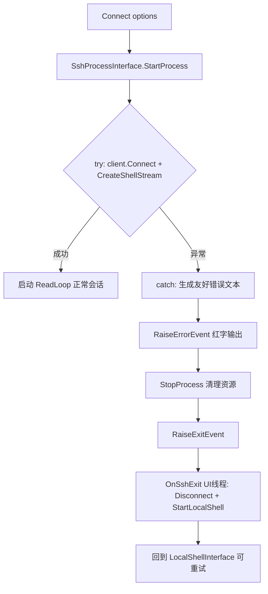

## 用户需求

当用户通过 SshProcessInterface 启动 Renci.SshNet 进行 SSH 连接失败时（密码错误、服务器不可用、连接超时、主机密钥不信任等），不再出现卡死无响应状态，而是回退到 LocalShellInterface。

## 产品概述

优化 SshWinFormConsole 的失败处理体验：在 SSH 连接建立阶段捕获所有连接/认证异常，向终端输出明确、友好的错误原因，并自动切换回本地 shell，使终端始终可用且能使用 `ssh user@host` 重新发起连接。

## 核心特性

- SSH 连接失败时在终端以红色文本显示具体错误原因（区分认证失败、连接超时/拒绝、主机密钥不信任等）。
- 连接失败后自动回退到 LocalShellInterface，恢复本地交互 shell 与命令输入能力。
- 回退后用户仍可输入 `ssh user@host` 重新连接（复用既有 SshConnectRequested 机制）。
- 任何连接失败路径均保证 client/shell 资源被正确释放，避免句柄泄漏与残留卡死状态。

## 技术栈

- 语言：VB.NET（WinForms），沿用现有 SShClient 项目
- 依赖：Renci.SshNet（SSH.NET），AbstractProcessInterface 基类事件模型
- 线程模型：StartProcess 在当前调用线程（UI 触发）；回退 UI 操作需 marshal 回 UI 线程（参照 OnSshExit 的 InvokeRequired 模式）

## 实现方案

### 策略概述

在 `SshProcessInterface.StartProcess()` 中为 `client.Connect()` 及后续 ShellStream 创建增加 try/catch，将连接/认证/超时/主机密钥等异常转换为人类友好的错误文本，通过 `RaiseErrorEvent` 上抛，并复用 `StopProcess()` 清理资源，最后 `RaiseExitEvent` 通知宿主。由 `SshWinFormConsole.OnSshExit` 已有逻辑（Disconnect + StartLocalShell）完成回退。这样不改动现有正常连接流程，仅填补异常路径。

### 关键技术决策

1. **在 StartProcess 内部捕获异常而非让异常冒泡**：当前异常冒泡到 `SshWinFormConsole.Connect()` 会导致 `sshInterface` 已赋值但未连接、且 OnSshExit/OnSshError 未驱动，形成卡死。改为在 StartProcess 内 try/catch，确保失败后立即 RaiseExitEvent，复用既有 OnSshExit 回退链路。
2. **友好错误分类**：依据异常类型映射文案——SshAuthenticationException→"认证失败（用户名或密码/密钥错误）"；SocketException/TimeoutException→"无法连接或连接超时（服务器不可用/网络不通）"；SshConnectionException（含主机密钥）→已通过 HostKeyReceived 处理，补充通用"连接被拒绝/SSH 协商失败"；兜底显示 ex.Message。
3. **资源清理**：catch 块中调用 `StopProcess()`（已有完整释放逻辑），保证 client/shell 为 Nothing、IsProcessRunning=False，无句柄泄漏。
4. **事件复用**：仅使用基类既有 `RaiseErrorEvent` / `RaiseExitEvent` 与宿主既有 `OnSshError` / `OnSshExit` 处理器，不新增破坏性接口。OnSshExit 已包含 InvokeRequired 的 UI 线程 marshal，回退安全。

### 性能与可靠性

- 失败路径为单次同步连接尝试，无额外轮询/重试开销。
- 异常捕获范围限于连接建立段（BuildConnectionInfo→Connect→CreateShellStream），不影响正常读循环 `ReadLoop`。
- 资源释放复用 StopProcess 的 SyncLock，避免并发释放竞争。

## 实现备注

- 不要在 `SshWinFormConsole.Connect()` 中新增 try/catch 包裹 `StartProcess()`；改为让 StartProcess 内部自洽处理失败并通过 Exit 事件驱动回退，保持与 OnSshExit 现有回退逻辑一致（其已打印 "SSH session closed." 并 StartLocalShell）。
- OnSshError 当前仅 WriteOutput 红色文本，无需改动；错误文案由 SshProcessInterface 生成。
- 注意 HostKeyReceived 处理器中"Host key not trusted"已 RaiseErrorEvent，但此时 client 尚未 Connect 成功，需在 catch 中一并清理并 RaiseExitEvent。
- 保持 AutoConnectOnFocus、OnGotFocus、OnTerminalResized 等既有行为不变。

## 架构设计

### 连接失败回退数据流



## 目录结构

本任务仅修改两个既有文件，不新增文件。

```
SShClient/
├── SshProcessInterface.vb   # [MODIFY] 在 StartProcess 的 BuildConnectionInfo/Connect/CreateShellStream 段增加 try/catch：
│                            #   捕获 SshAuthenticationException、SocketException、TimeoutException、SshConnectionException 等；
│                            #   生成友好错误文本并 RaiseErrorEvent；调用 StopProcess 清理；RaiseExitEvent 通知回退。
│                            #   保证任何失败路径下 client/shell 资源释放、IsProcessRunning=False。
└── SshWinFormConsole.vb     # [MODIFY] 无需新增回退代码；确认 OnSshExit 已通过 Disconnect+StartLocalShell 完成回退。
                             #   可选：在 OnSshExit 文案中区分"会话结束"与"连接失败回退"，提升可读提示（最小改动）。
```

## 关键代码结构

SshProcessInterface.StartProcess 现有签名保持不变，仅内部增加异常处理，不改动公共接口：

```
Public Overrides Sub StartProcess()
    If IsProcessRunning Then Return
    If Options Is Nothing OrElse Not Options.IsValid() Then
        RaiseErrorEvent("Invalid SSH connection options ..." & Environment.NewLine)
        Return
    End If

    SyncLock sync
        Try
            Dim info = BuildConnectionInfo()
            client = New SSH.SshClient(info)
            client.KeepAliveInterval = TimeSpan.FromSeconds(30)
            AddHandler client.HostKeyReceived, ...
            client.Connect()
            shell = client.CreateShellStream(...)
            runRead = True
            readThread = New Thread(AddressOf ReadLoop)
            readThread.IsBackground = True
            readThread.Name = "SshShellReader"
            readThread.Start()
        Catch ex As Exception
            RaiseErrorEvent(BuildFriendlyMessage(ex))
            StopProcess()
            RaiseExitEvent()
        End Try
    End SyncLock
End Sub
```