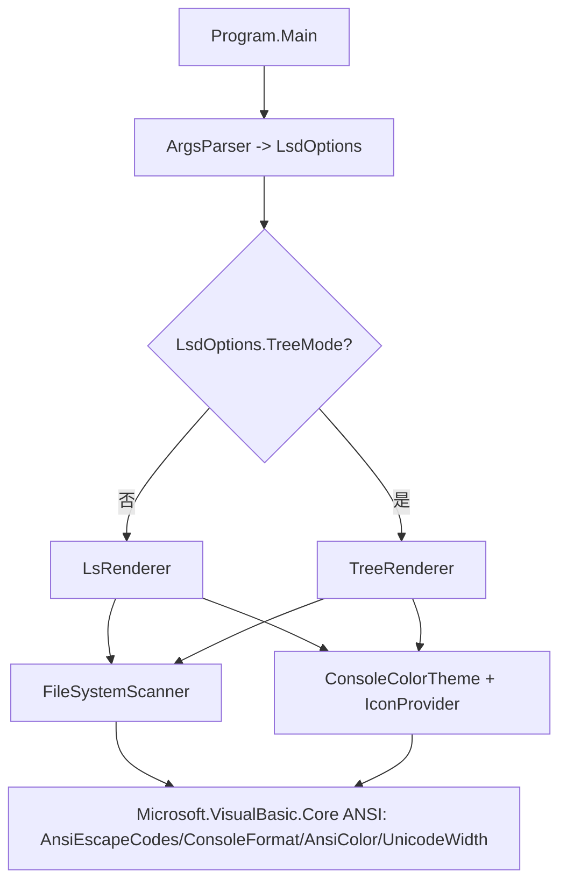

## 用户需求

在 `g:/mini-R/src/console/bash/lsd` 的 `lsd.vbproj` 项目中实现一个模拟 bash `ls` 命令的命令行程序 `lsd.exe`。程序需精准模拟 bash `ls` 的功能与输出语义，并在命令行输出上做样式优化：通过 ANSI escape sequence 对结果设置样式（文件类型相关颜色、权限相关颜色、文件名/文件夹名前显示对应图标）。同时新增与 linux `tree` 命令一致的文件夹文件树展示功能。必须复用 `Microsoft.VisualBasic.Core` 中 `ApplicationServices.Terminal` 下的 ANSI 基础代码库（使用 `AnsiEscapeCodes.AppendAnsiEscapeSequence` 等）。

## 产品概述

一个 Windows/.NET 控制台工具 `lsd`，既可作为彩色增强版 `ls`（模拟 bash 行为），也可作为彩色文件树查看器（`tree` 模式）。通过 Unicode 图标、文件类型配色与权限配色，使目录浏览更直观；并保证与 bash `ls` 输出语义一致。

## 核心功能

- **ls 基础列表**：默认按列多列显示目录项；支持 `-a`（含 `.`/`..`）、`-A`（含隐藏但不含 `.`/`..`）。
- **长格式 (-l)**：输出 `权限 链接数 所有者 组 大小 月 日 时间 名称`（含图标），权限字符串按 bash 语义生成（含文件类型字符与 rwx 位）。
- **排序**：`-t`（按修改时间）、`-S`（按大小）、`-r`（反向）；默认按名称字典序。
- **递归 (-R) 与多路径**：`-R` 递归列出子目录；支持多个路径参数，逐路径输出 `path:` 标题。
- **tree 模式 (-t)**：以树形缩进展示目录结构；`-depth=N`（如 `-depth=2`）控制递归深度，默认不限深度。
- **样式渲染**：目录、可执行、图片、压缩包、符号链接等文件类型使用不同颜色与 Unicode 图标（如 📁 目录、🖼️ 图片、📄 普通文件等）；权限位按类型着色（如可执行绿色、可写红色等）。
- **输出控制**：`--color=auto/always/never`（auto 时检测管道/重定向自动关闭彩色）、`--help` 帮助信息、`-v` 版本信息。

## 技术栈选择

- 语言/框架：VB.NET（.NET 10，与现有 `lsd.vbproj` 一致），控制台可执行程序（Exe）。
- 基础库：复用 `Microsoft.VisualBasic.Core` 中 `ApplicationServices.Terminal` 命名空间下的 ANSI 库：`AnsiEscapeCodes`、`ConsoleFormat`、`AnsiColor`、`TextSpan`、`UnicodeWidth`。
- 样式输出：使用 `AnsiEscapeCodes.AppendAnsiEscapeSequence(sb, format)` 与 `AnsiColor`（含 `Rgb` 24-bit 自定义色）构造彩色文本；对齐宽度用 `UnicodeWidth.GetWidth`。
- 文件信息：使用 `System.IO.DirectoryInfo` / `FileInfo`、`File.GetAttributes`、`FileSystemInfo` 获取类型、权限位、大小、时间。

## 实现方案

### 总体策略

在 `lsd` 项目内实现模块化 VB.NET 代码，将命令行解析、文件信息收集、样式映射、ls 渲染、tree 渲染分离。`Program.Main` 解析参数后分派到 ls 模式或 tree 模式。所有彩色输出统一经由 `ConsoleFormat` + `AnsiEscapeCodes` 生成，确保复用基础库；如基础库缺少某 helper（例如 文件类型→ConsoleFormat 的集中映射），在基础库新增最小辅助方法而非另造 ANSI 拼接逻辑。

### 关键技术决策

1. **参数解析**：自实现一个轻量 `LsdOptions` 解析器，支持短选项聚合（`-alR`）、长选项（`--color=`、`--help`）与 `-depth=` 等号赋值；路径参数收集到列表。理由：避免引入第三方依赖，与项目纯 VB.NET 风格一致。
2. **样式映射集中化**：新增 `ConsoleColorTheme`（可置于 lsd 项目内）维护「文件类型 → ConsoleFormat + 图标字符」「权限位 → ConsoleFormat」映射，便于扩展与统一。
3. **对齐与列布局**：非 `-l` 模式按终端宽度（`Console.BufferWidth`，管道时回退固定值）计算列数，使用 `UnicodeWidth.GetWidth` 计算含 emoji 的显示宽度以保证对齐；`-l` 模式各字段按最大宽度右对齐/左对齐。
4. **ansi 基础库扩展**：当前 `AppendAnsiEscapeSequence` / `ConsoleFormat` / `AnsiColor.Rgb` 已能覆盖颜色与样式需求，预计无需大幅改动；仅在缺少便捷映射时（如「根据扩展名/属性返回图标+颜色」）在 lsd 项目内实现，保持基础库改动最小、向后兼容。

### 性能与可靠性

- 目录枚举为 O(n)，排序 O(n log n)，彩色拼接使用 `StringBuilder` 单次构建后输出，避免逐字符写屏造成刷屏卡顿。
- 递归（`-R`/`-t`）使用显式深度/栈控制，避免无限递归（符号链接循环）导致栈溢出；`-depth=` 限制 tree 深度。
- 管道检测（`Console.IsOutputRedirected` 或进程标准输出重定向）用于 `--color=auto` 自动关闭彩色，避免破坏日志/管道解析。
- 路径不存在、无权限访问子目录时使用 `Try...Catch` 输出类 bash 的错误信息（`lsd: cannot access 'x': No such file or directory`）到 stderr，不中断其他路径。

## 实现注意事项

- 严格复用 `AnsiEscapeCodes.AppendAnsiEscapeSequence`，不要手拼 `\x1b[...m`；如确需新 ANSI 能力（如链接下划线组合）优先扩展 `ConsoleFormat`/`AnsiColor` 并调用原 API。
- emoji 图标宽度为 2，必须用 `UnicodeWidth.GetWidth` 计算列对齐，否则长格式/多列会错位。
- 保持与 bash `ls` 输出语义一致：默认不含隐藏文件；`-l` 时间格式为 `MMM dd HH:mm`（旧文件为 `MMM dd  yyyy`）；符号链接显示为 `name -> target`。
- 向 ANSI 基础库新增代码时保持现有 GPL3 头与命名空间 `ApplicationServices.Terminal` 风格，避免破坏其他引用方。

## 架构设计

### 模块关系



各模块职责单一：解析、扫描、样式、渲染解耦，便于后续增加新选项。

## 目录结构

```
g:/mini-R/src/console/bash/lsd/
├── lsd.vbproj              # [MODIFY] 已引用 Core.vbproj，保持不变；如需新依赖再行添加
├── Program.vb             # [MODIFY] 重写 Main：解析参数、分派 ls/tree 模式、--help/-v、错误处理
├── ArgsParser.vb          # [NEW] 解析命令行参数为 LsdOptions：支持 -a/-A/-l/-t/-r/-S/-R、--color=、--help、-v、-depth=N、多路径
├── LsdOptions.vb          # [NEW] 选项数据类：ShowAll/AlmostAll/LongFormat/TreeMode/SortBy/Recursive/Reverse/ColorMode/Depth/Paths
├── FileSystemScanner.vb   # [NEW] 枚举目录/文件，构建 FileEntry（名称、属性、大小、时间、目标链接），多路径与 -R 递归收集
├── ConsoleColorTheme.vb   # [NEW] 文件类型→ConsoleFormat 与权限位→ConsoleFormat 的配色映射（参考 lsd 经典配色）
├── IconProvider.vb        # [NEW] 文件类型/扩展名→Unicode 图标字符映射（目录📁、图片🖼️、压缩包🗜️、可执行⚙️、链接🔗等）
├── LsRenderer.vb          # [NEW] 实现 ls 输出：多列对齐（默认）、-l 长格式、排序、递归 -R 标题
└── TreeRenderer.vb        # [NEW] 实现 tree 输出：树形缩进、分支符号、深度控制 -depth=N

G:/GCModeller/src/runtime/sciBASIC#/Microsoft.VisualBasic.Core/src/ApplicationServices/Terminal/MarkdownRender/ANSI/
└── AnsiEscapeCodes.vb     # [MODIFY 可选] 若需便捷 helper（如包装 文件类型样式）在此最小扩展，复用 AppendAnsiEscapeSequence；保守原则下优先 lsd 内实现
```

## 关键代码结构（可选，核心类型）

```
' LsdOptions.vb
Public Class LsdOptions
    Public ShowAll As Boolean        ' -a
    Public AlmostAll As Boolean      ' -A
    Public LongFormat As Boolean     ' -l
    Public TreeMode As Boolean       ' -t
    Public SortByTime As Boolean     ' -t 复用名冲突? 使用 SortTime
    Public SortBySize As Boolean     ' -S
    Public Reverse As Boolean        ' -r
    Public Recursive As Boolean      ' -R
    Public ColorMode As String       ' auto/always/never
    Public Depth As Integer = -1     ' -depth=N, -1=无限制
    Public Paths As New List(Of String)
End Class

' FileEntry (FileSystemScanner.vb)
Public Class FileEntry
    Public Name As String
    Public FullPath As String
    Public IsDirectory As Boolean
    Public IsHidden As Boolean
    Public IsSymlink As Boolean
    Public IsExecutable As Boolean
    Public Size As Long
    Public LastWrite As DateTime
    Public LinkTarget As String
    Public PermissionString As String ' 如 drwxr-xr-x
End Class
```

## Agent Extensions

### SubAgent

- **code-explorer**
- Purpose: 在实现前深入探索 `Microsoft.VisualBasic.Core` 的 ANSI 基础库与其他潜在可复用 API（如文件属性/权限的 .NET 封装），确认 `AppendAnsiEscapeSequence` 与 `ConsoleFormat` 的完整契约，避免误用。
- Expected outcome: 产出 ANSI 库与文件系统相关 API 的准确用法清单，确保实现直接复用且不破坏现有调用方。